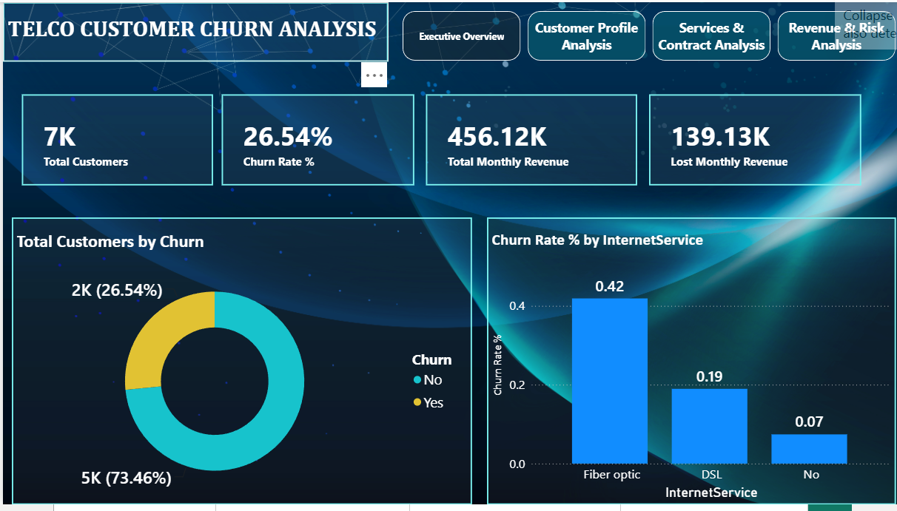

# Telco Customer Churn Analysis | Power BI Dashboard

**Live Portfolio:** https://muhammad-ali-azam.github.io

### 📊 Overview
A comprehensive 4-page dashboard to analyze customer churn behavior in the telecom sector. Helps identify high-risk customers, churn reasons, and revenue impact to reduce customer attrition.

### 📑 4 Pages Included:
1.  **Executive Overview** - KPIs: Total Customers, Churn Rate, Revenue & Lost Revenue (Screenshot Attached)
2.  **Customer Profile Analysis** - Demographics & customer segmentation
3.  **Services & Contract Analysis** - Internet service, contract type impact on churn
4.  **Revenue & Risk Analysis** - Financial impact and risk assessment

### 📁 Files in this Repository
- `3.png` - Executive Overview Page Preview
- `3. Telco Customer Churn Analysis.pbix` - Complete 4-Page Power BI File

### 🛠️ Tools Used
- Power BI Desktop, DAX, Data Modeling
- Churn Analysis & Customer Segmentation

### 💡 Key Insights (From Executive Overview Page)
- **7K** Total Customers | **26.54%** Churn Rate (2K churned, 5K retained)
- **456.12K** Total Monthly Revenue | **139.13K** Lost Revenue
- **Critical Finding:** Fiber optic users have highest churn (42%) vs DSL (19%)

### 🎯 Business Impact
This dashboard helps the retention team to focus on high-risk Fiber optic customers to reduce churn and recover lost revenue.

---
*Developed by Muhammad Ali Azam | Data Analyst from Multan*
